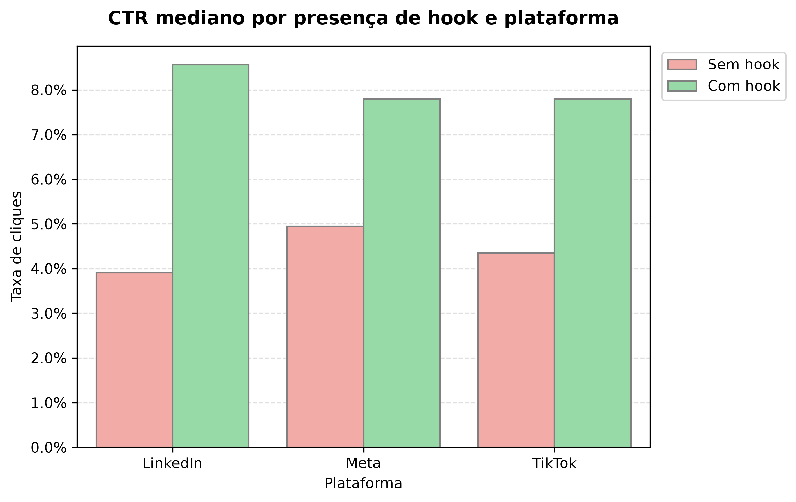
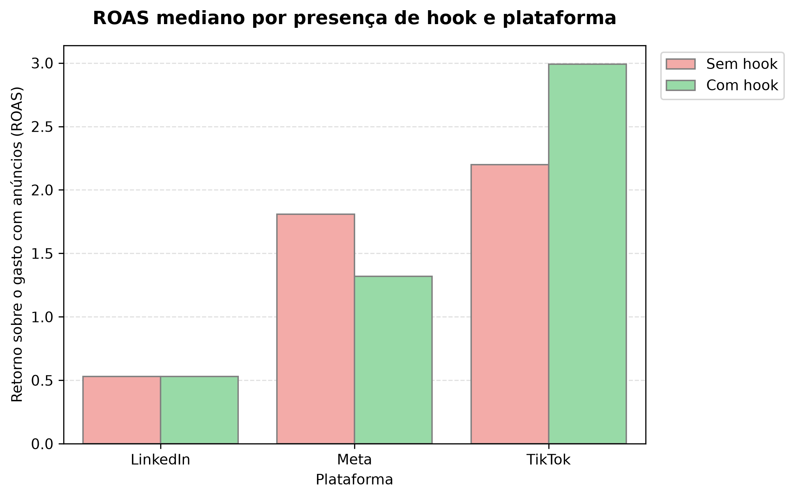
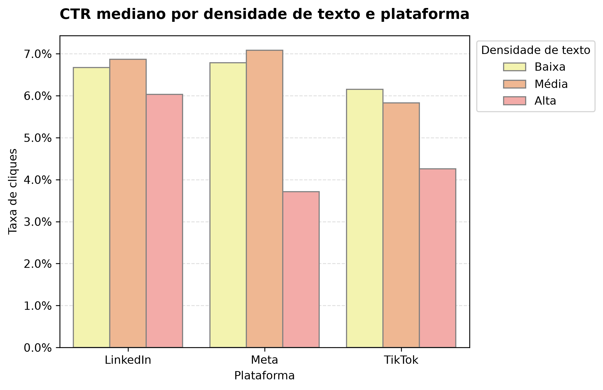

# Klike Data Science Challenge

**Autora:** Laura de Oliveira  
**Processo seletivo:** Estágio de Férias — Klike.ai / Millai  
**Data:** Outubro de 2026

O projeto tem como objetivo analisar dados de campanhas publicitárias em vídeo, identificar padrões de desempenho, desenvolver um modelo preditivo para o `klike_score` e construir um sistema de recomendações para otimização de criativos.

## Como executar o projeto

### Pré-requisitos

- Python 3.10 ou superior
- Git
- Ambiente virtual Python (`env`)

### Configuração do ambiente

**1. Clone o repositório**

```bash
git clone https://github.com/lauradeoli/klike-ds-challenge-lauradeoli.git
cd klike-ds-challenge-lauradeoli
```

**2. Crie um ambiente virtual**

```bash
python -m venv env
```

**3. Ative o ambiente virtual**

No Windows (PowerShell):

```powershell
.\env\Scripts\Activate.ps1
```

No Linux/macOS:

```bash
source env/bin/activate
```

**4. Instale as dependências**

```bash
python -m pip install -r requirements.txt
```

Abra o arquivo `notebooks/parte1_eda.ipynb` para iniciar a exploração dos dados. Depois, siga para `notebooks/parte2_modelagem.ipynb` para a construção do modelo. Então, `notebooks/parte3_recomendacoes.ipynb` apresenta a construção e lógica por trás do sistema de recomendações. Por último, `notebooks/recommendations_engine.ipynb` representa o notebook interativo onde é possível testar as recomendações para cada campanha presente no dataset. 

### Executando o Recommendations Engine

Após instalar as dependências e selecionar o ambiente Python no Jupyter ou VS Code:

1. Abra `notebooks/recommendations_engine.ipynb`.
2. Execute as células na ordem apresentada.
3. Informe o número de uma campanha no campo interativo (por exemplo, `90` para `KLK-0090`).
4. Clique em **Gerar recomendações**.

O sistema carrega e prepara automaticamente os dados antes de executar a análise.

As recomendações serão exibidas abaixo do formulário, acompanhadas das evidências observadas.

**Observação:** execute o notebook a partir da pasta `notebooks/`, conforme a configuração atual dos caminhos do projeto.


## Estrutura do projeto

```text
klike-ds-challenge-lauradeoli/
├── data/
│   └── klike_challenge_dataset.csv
├── images/
│   ├── CTR-hook-plataforma-1.png
│   ├── CTR-texto-plataforma-3.png
│   └── ROAS-hook-plataforma-2.png
├── notebooks/
│   ├── parte1_eda.ipynb
│   ├── parte2_modelagem.ipynb
│   ├── parte3_recomendacoes.ipynb
│   └── recommendations_engine.ipynb
├── src/
│   └── recommendations.py
├── .gitignore
├── README.md
└── requirements.txt
```

## 1. Análise Exploratória dos Dados (EDA)

### 1.1 Qual o perfil geral dos dados?

O dataset contém 500 registros e 26 variáveis, abrangendo características dos criativos, informações das campanhas e métricas de performance.

Durante a exploração, foram identificados valores ausentes em sete variáveis, distribuições numéricas predominantemente assimétricas à direita e observações extremas, especialmente nas métricas de alcance e retorno financeiro. Não foram encontradas linhas completamente duplicadas.

**Decisões de tratamento:** Considerando o tamanho reduzido da base, optei por preservar os registros durante a EDA para evitar a perda de campanhas potencialmente relevantes. Valores ausentes poderão ser tratados conforme o tipo de variável e os requisitos dos modelos, enquanto outliers deverão ser investigados antes de possíveis correções ou exclusões.

Também foram identificadas inconsistências pontuais no CPC, que mereceriam investigação adicional em uma etapa de limpeza dos dados.

### 1.2 Quais atributos dos criativos mais se relacionam com boas métricas de performance?

Inicialmente, utilizei o CTR como referência para investigar características associadas à atração de cliques. Entretanto, percebi que essa métrica isoladamente não seria suficiente para avaliar campanhas com diferentes objetivos. Por isso, ampliei a investigação para incluir CPC, ROAS, conversões, receita, engajamento e tempo médio de visualização.

As principais associações identificadas foram:

- **Hook e rosto humano:** associados a maiores medianas de CTR, engajamento, conversões e tempo de visualização, mas a menores medianas de ROAS.
- **CTA:** associado a maiores medianas de conversões, receita e ROAS.
- **Densidade de texto:** criativos com alta densidade apresentaram menores medianas de CTR, ROAS, conversões e receita em comparação com os de baixa densidade.

A análise de correlação de Spearman não identificou associações monotônicas fortes entre os atributos numéricos dos criativos e as métricas de performance avaliadas.

Esses resultados demonstram que características associadas a mais cliques ou interações não necessariamente apresentam melhores resultados financeiros.

### 1.3 Existem padrões diferentes por plataforma? O que funciona no TikTok funciona no LinkedIn?

Sim, foram identificadas diferenças nos padrões de performance entre Meta, TikTok e LinkedIn.

A presença de hook esteve associada a CTR mediano superior nas três plataformas. Entretanto, a relação com o ROAS foi distinta:

- **TikTok:** ROAS mediano de 2,20x sem hook e 2,99x com hook.
- **Meta:** ROAS mediano de 1,81x sem hook e 1,32x com hook.
- **LinkedIn:** ROAS mediano de 0,53x em ambos os grupos.

Além disso, criativos com alta densidade de texto apresentaram CTR mediano inferior nas três plataformas, com diferença particularmente expressiva no Meta.

Portanto, embora algumas associações se repitam entre plataformas, outras variam conforme o contexto. Isso reforça a necessidade de considerar a plataforma, o objetivo e a métrica de interesse antes de formular recomendações de otimização.

### 1.4 Visualizações para o time de marketing

Foram selecionadas três visualizações para comunicar os principais insights da EDA de maneira acessível, priorizando descobertas com possíveis aplicações na otimização de criativos.

**Gráfico 1 — CTR mediano por presença de hook e plataforma**



#### Insight 1 — Presença de hook e CTR

A presença de um hook nos primeiros três segundos está associada a um CTR mediano superior nas três plataformas analisadas. Essa diferença é especialmente expressiva no LinkedIn, sugerindo que a abertura do vídeo pode ser um elemento relevante para despertar o interesse do público e incentivar cliques.

**Para o time de marketing**, esse resultado indica que vale a pena dar atenção à construção dos primeiros segundos dos criativos. Uma possibilidade seria testar diferentes formas de apresentar a mensagem inicial, como perguntas, demonstrações do produto ou afirmações que despertem curiosidade. Entretanto, os dados mostram apenas a presença ou ausência do hook, sem informações sobre seu conteúdo ou qualidade. Portanto, não é possível concluir qual abordagem seria mais eficiente, nem afirmar que a inclusão de um hook, isoladamente, aumentaria o CTR.

**Gráfico 2 — ROAS mediano por presença de hook e plataforma**



#### Insight 2 — Presença de hook e ROAS

Embora campanhas com hook apresentem CTR mediano superior nas três plataformas, a relação com o retorno financeiro não segue o mesmo padrão. No TikTok, campanhas com hook apresentam **ROAS mediano aproximadamente 35,9% maior**, enquanto no Meta o ROAS mediano é **27,1% menor**. No LinkedIn, não foi observada diferença entre os grupos.

Esse contraste é particularmente interessante porque mostra que uma característica associada a mais cliques não necessariamente está associada a maior retorno financeiro. Para campanhas cujo objetivo principal é gerar receita, não seria suficiente recomendar a inclusão de um hook apenas com base no CTR. **A decisão precisa considerar tanto a plataforma quanto a métrica que se deseja otimizar.** No TikTok, por exemplo, os resultados justificariam investigar mais a fundo o uso de hooks, enquanto no Meta seria importante entender por que o mesmo atributo apresenta uma associação diferente com o ROAS. Essas comparações são observacionais e podem ser influenciadas por outras características das campanhas.

**Gráfico 3 — CTR mediano por densidade de texto e plataforma**



#### Insight 3 — Densidade de texto e CTR

Criativos com alta densidade de texto apresentam CTR mediano inferior aos demais grupos nas três plataformas, com a diferença mais expressiva no Meta. Entretanto, a relação não é simplesmente de que menos texto significa melhor desempenho: no Meta e no LinkedIn, a densidade média apresenta CTR mediano ligeiramente superior à baixa.

**Para o time de marketing**, esse resultado sugere que a quantidade de texto exibida na tela merece atenção durante a criação dos anúncios. Em vez de eliminar textos indiscriminadamente, seria interessante testar versões com mensagens mais objetivas, priorizando informações essenciais e evitando excesso de elementos visuais. Ao mesmo tempo, o desempenho relativamente melhor da densidade média em algumas plataformas indica que o texto também pode contribuir para comunicar a proposta do anúncio. Assim, o objetivo não seria necessariamente utilizar o mínimo possível de texto, mas encontrar um equilíbrio adequado ao criativo e à plataforma.

Como a análise considera apenas categorias de densidade, não é possível determinar a quantidade ideal de texto ou avaliar aspectos como legibilidade, posicionamento e conteúdo das mensagens. Esses fatores poderiam ser investigados em análises futuras.

### Limitações da análise

Os resultados apresentados representam associações observadas nos dados e não permitem estabelecer causalidade. Além disso, métricas absolutas, como receita e conversões, podem ser influenciadas pela escala das campanhas.

Essas limitações deverão ser consideradas na construção do sistema de recomendações, evitando apresentar diferenças estatísticas observadas como melhorias garantidas.

## 2. Modelagem Preditiva

### 2.1 Quais features foram selecionadas e por quê?

O objetivo da modelagem foi prever o `klike_score` utilizando informações disponíveis **antes da veiculação da campanha**. Essa escolha considera um cenário em que o anunciante deseja avaliar e melhorar seu criativo antes de publicá-lo.

Foram selecionadas 13 features, divididas em dois grupos:

- **Contexto da campanha:** plataforma, categoria, objetivo, faixa etária do público-alvo e retargeting.
- **Características do criativo:** duração, formato, presença de legendas, CTA, hook, rosto humano, densidade de texto e proporção entre música e voz.

Métricas como CTR, ROAS e conversões foram excluídas por dependerem da veiculação da campanha. Utilizá-las tornaria o modelo incompatível com o cenário de uso escolhido.

**Pré-processamento:** foram utilizados imputação de valores ausentes, One-Hot Encoding para variáveis nominais, Ordinal Encoding para variáveis ordenadas e padronização das numéricas. As transformações foram ajustadas apenas nos dados de treinamento para evitar vazamento de informações.

Não foram criadas features derivadas adicionais. A engenharia de features concentrou-se na seleção e transformação das variáveis disponíveis.

### 2.2 Quais modelos foram treinados e como foram avaliados?

Foram comparados dois modelos de regressão:

- **Ridge Regression:** modelo linear com regularização L2, que oferece simplicidade e facilidade de interpretação.
- **Random Forest Regressor:** modelo baseado em árvores de decisão, capaz de capturar relações não lineares e interações entre variáveis.

Também foi utilizado um `DummyRegressor`, que prevê a média do alvo, como referência mínima de desempenho (*baseline*).

O dataset foi dividido em 80% para treinamento e 20% para teste. Os modelos foram avaliados utilizando MAE, RMSE e R².

**Resultados no conjunto de teste:**

| Modelo | MAE ↓ | RMSE ↓ | R² ↑ |
|---|---:|---:|---:|
| DummyRegressor | 13,84 | 16,80 | -0,001 |
| Ridge | 8,59 | **10,39** | **0,617** |
| Random Forest | **8,31** | 10,43 | 0,614 |

Ambos os modelos de regressão superaram o baseline, indicando que as features selecionadas contêm informações úteis para prever o `klike_score`, mesmo sem métricas de performance pós-veiculação.

**Interpretação prática:** considerando que o `klike_score` varia de 0 a 100, o MAE de 8,59 indica que as previsões do Ridge apresentam um erro absoluto médio de aproximadamente 8,6 pontos. Embora represente uma melhoria expressiva em relação ao baseline, essa margem de erro pode ser relevante para o produto, especialmente ao comparar criativos com pontuações próximas.

Por isso, o score previsto deve ser interpretado como uma estimativa de qualidade, e não como uma avaliação exata. Na aplicação prática, seria importante comunicar essa incerteza ao usuário, evitando que pequenas diferenças entre pontuações sejam tratadas como evidências conclusivas de superioridade de um criativo.

### 2.3 Qual modelo foi selecionado?

Embora o Random Forest tenha apresentado MAE ligeiramente inferior, a comparação entre treino e teste revelou sinais expressivos de *overfitting*: seu R² caiu de 0,940 para 0,614, enquanto o MAE aumentou de 2,93 para 8,31 pontos.

Para complementar a avaliação, foi realizada validação cruzada com cinco folds no conjunto de treinamento:

| Modelo | MAE médio | Desvio-padrão |
|---|---:|---:|
| Ridge | 8,06 | 0,50 |
| Random Forest | **7,80** | 0,53 |

Os modelos apresentaram resultados próximos, com pequena vantagem do Random Forest no MAE médio.

**O Ridge foi selecionado como modelo final.** Apesar da pequena vantagem preditiva do Random Forest, o Ridge apresentou menor diferença entre treino e teste e permite uma interpretação mais direta das relações entre as features e o score.

No conjunto de teste, o modelo selecionado obteve MAE de **8,59 pontos** e R² de **0,617**, reduzindo o erro absoluto médio em aproximadamente 38% em relação ao baseline.

### 2.4 Quais variáveis mais se relacionam com o score?

Para interpretar o modelo selecionado, foram analisados os coeficientes do Ridge.

Os maiores coeficientes positivos foram observados para:

| Atributo | Coeficiente |
|---|---:|
| Presença de hook | +16,88 |
| Presença de rosto humano | +10,42 |
| Presença de CTA | +8,06 |
| Presença de legendas | +7,48 |

Como esses atributos são booleanos, os coeficientes representam diferenças no score previsto entre a ausência e a presença de cada característica, mantendo as demais variáveis constantes.

Esses resultados apresentam conexões com a EDA: hooks e rostos humanos estiveram associados a maiores medianas de CTR e engajamento, enquanto CTAs apresentaram associações positivas com métricas de conversão e retorno financeiro.

A densidade de texto apresentou coeficiente negativo (-2,49), coerente com as associações negativas observadas na análise exploratória.

Entretanto, a magnitude dos coeficientes não representa uma medida diretamente comparável de importância entre todas as features, devido às diferenças de escala e codificação.

### Limitações da modelagem

O dataset contém apenas 500 campanhas, e a fórmula utilizada para calcular o `klike_score` não foi disponibilizada. Portanto, não é possível determinar todos os fatores que influenciam sua construção.

Além disso, os coeficientes descrevem associações aprendidas pelo modelo, não efeitos causais. Alterar uma característica do vídeo não garante a variação correspondente no score ou nas métricas de performance.

Essas limitações serão consideradas na construção do Recommendations Engine, que deverá utilizar os resultados como evidências para formular hipóteses de otimização, sem prometer melhorias garantidas.

## Parte 3 — Recommendations Engine

### Abordagem

O objetivo desta etapa foi desenvolver um sistema capaz de analisar uma campanha e gerar sugestões específicas de melhoria do criativo. Optei por uma abordagem baseada em **comparações de medianas de performance por plataforma e atributo**, priorizando a interpretabilidade e a simplicidade da solução.

O engine analisa oito características modificáveis do vídeo em relação a cinco métricas: CTR, ROAS, taxa de engajamento, taxa de conversão e proporção assistida do vídeo. Para evitar recomendações baseadas em grupos muito pequenos ou diferenças pouco expressivas, estabeleci dois critérios: **pelo menos 10 observações válidas por grupo e diferença mínima de 10% entre as medianas**.

### Geração e priorização das recomendações

O sistema identifica alternativas associadas a melhores resultados dentro da mesma plataforma e seleciona até cinco recomendações, evitando sugestões repetidas para um mesmo atributo.

A seleção considera inicialmente a métrica principal de cada campanha, definida a partir de seu objetivo, e depois incorpora oportunidades relacionadas às demais métricas. As recomendações finais são ordenadas pela diferença percentual observada.

Para tornar as sugestões mais acionáveis, alterações de duração e proporção música/voz são apresentadas com valores numéricos concretos, calculados a partir das medianas dos grupos recomendados.

### Protótipo interativo

Desenvolvi uma interface interativa com `ipywidgets`, na qual é possível informar o identificador de uma campanha existente e visualizar as recomendações em linguagem natural, acompanhadas das métricas e diferenças percentuais que as fundamentam.

O protótipo está disponível em **[`notebooks/recommendations_engine.ipynb`](notebooks/recommendations_engine.ipynb)**.

A construção da lógica, as decisões metodológicas e os testes estão documentados em **[`notebooks/parte3_recomendacoes.ipynb`](notebooks/parte3_recomendacoes.ipynb)**.

### Limitações

As recomendações são baseadas em **associações observadas no dataset**, e não em relações causais. Portanto, as diferenças percentuais representam comparações entre grupos, não previsões de ganhos garantidos.

Outra limitação é que as alterações são analisadas individualmente, sem estimar como diferentes recomendações poderiam interagir quando aplicadas em conjunto.

Durante o desenvolvimento, também explorei a possibilidade de utilizar o Ridge da Parte 2 para estimar alterações no `klike_score`. Pensei que, ao final das até 5 recomendações no sistema, ele poderia mostrar o aumento no `klike_score` caso todas elas tivessem sido implementadas. Entretanto, encontrei situações em que recomendações favoráveis às métricas de marketing reduziam o score previsto. Optei por manter o engine orientado às métricas de performance e discutir essa divergência como oportunidade de evolução futura.

## Parte 4 — Visão de Produto

### 1. Quais features adicionais eu extrairia dos vídeos?

Com acesso aos vídeos originais, eu buscaria extrair características que permitissem entender não apenas **quais elementos estão presentes no criativo, mas como eles são utilizados**. Algumas features que considero interessantes são o ritmo de edição, o sentimento transmitido pela narração/áudio, o tempo de exposição de rostos humanos, o tipo de música e o momento em que o produto aparece pela primeira vez.

Acredito que essas informações poderiam tornar as recomendações mais específicas e úteis para a criação de novos anúncios. Atualmente, o engine consegue sugerir, por exemplo, a inclusão de um hook nos primeiros segundos, mas não consegue indicar como esse hook poderia ser construído. Com uma análise mais detalhada do conteúdo audiovisual, seria possível investigar quais abordagens estão associadas a melhores resultados e oferecer sugestões que vão além de simplesmente adicionar ou remover elementos do vídeo.

### 2. Como eu colocaria o Recommendations Engine em produção?

Eu manteria a lógica geral do protótipo, mas separaria o sistema em componentes para facilitar sua integração à plataforma Klike. Imagino uma arquitetura em que o usuário envia ou seleciona um criativo pela interface, enquanto um serviço de processamento extrai suas características e consulta os dados históricos das campanhas. O Recommendations Engine funcionaria como um serviço Python, disponibilizado por uma API, responsável por analisar os atributos e retornar recomendações estruturadas para a interface.

Para garantir escalabilidade, a extração de características dos vídeos poderia ocorrer de forma assíncrona, utilizando uma fila de tarefas, evitando que processamentos mais demorados bloqueassem a aplicação. As recomendações seriam geradas a partir de estatísticas armazenadas e atualizadas periodicamente, enquanto novas campanhas poderiam ser incorporadas continuamente à base. Também considero importante manter um monitoramento dos resultados e uma revisão periódica por profissionais, para identificar inconsistências e avaliar a qualidade das sugestões.

Em uma evolução do produto, gostaria de integrar um modelo capaz de considerar **combinações de alterações**, e não apenas atributos isolados, como acontece no protótipo atual. Isso permitiria investigar como diferentes recomendações interagem e estimar seus efeitos conjuntos sobre as métricas de performance, tornando o sistema mais próximo de uma ferramenta de apoio à otimização de criativos.

### 3. O que eu faria se tivesse mais tempo?

Minha primeira prioridade seria investigar melhor a relação entre o **Klike Score e as métricas de performance**. Durante o desenvolvimento, tentei utilizar o Ridge para estimar como as recomendações afetariam o score, mas encontrei situações em que alterações associadas a melhores resultados de marketing reduziam a pontuação prevista. Gostaria de entender melhor os fatores considerados no cálculo do Klike Score e explorar uma priorização que levasse em conta tanto a qualidade do criativo quanto seus resultados de performance, mantendo o sistema alinhado à proposta do Klike.

Também aprofundaria a análise incluindo informações como público-alvo e data de veiculação. Seria interessante investigar, por exemplo, se determinados tipos de criativo apresentam comportamentos diferentes entre faixas etárias ou dias da semana. Outra melhoria importante seria identificar conflitos entre recomendações e trabalhar com **otimização multiobjetivo**, considerando possíveis efeitos positivos e negativos sobre diferentes indicadores.

Por fim, considero que uma das principais limitações do projeto é o tamanho do dataset, com apenas 500 campanhas distribuídas entre diferentes plataformas e características. Isso restringe a possibilidade de realizar comparações mais específicas sem reduzir excessivamente o número de observações por grupo. Além disso, as recomendações são baseadas em associações observadas, sem demonstrar relações de causa e efeito. Com uma base maior, dados reais e mais tempo, gostaria de avaliar a estabilidade dessas relações e realizar testes A/B para verificar se as alterações sugeridas realmente produzem melhorias nas campanhas.